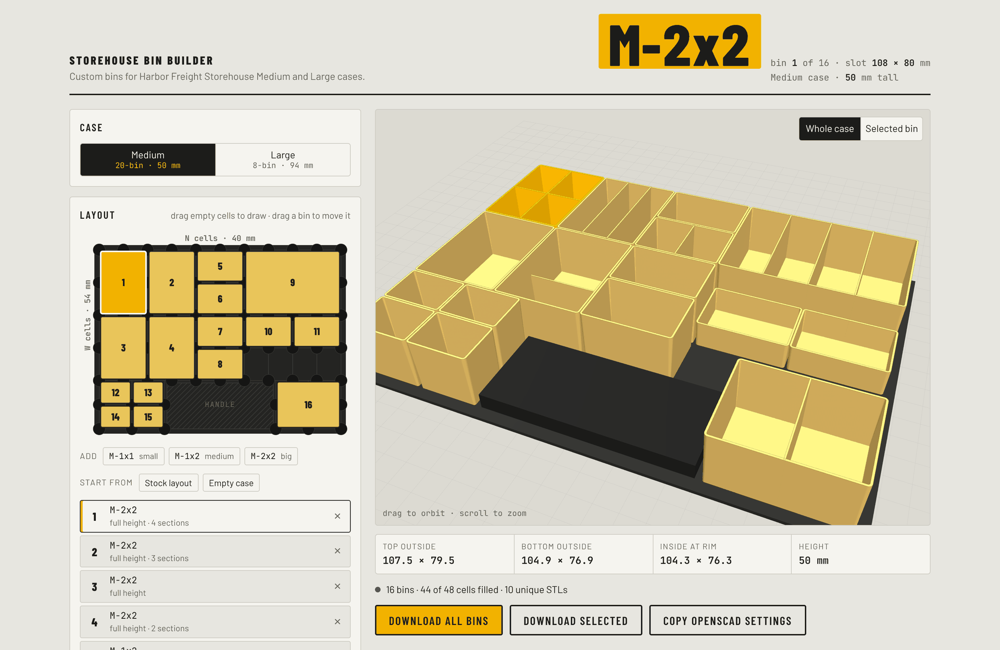

# Storehouse Bin Builder

Print custom bins that drop right into Harbor Freight STOREHOUSE parts cases. Draw the bins you want on the case floor, preview them in 3D, and download every STL in one zip.

Works with:

- [20-Bin Medium Portable Parts Storage Case](https://www.harborfreight.com/20-bin-medium-portable-parts-storage-case-93928.html)
- [8-Bin Large Portable Parts Storage Case](https://www.harborfreight.com/8-bin-portable-parts-storage-case-93927.html)

## Use it

**[Open the Storehouse Bin Builder](https://philhoyt.github.io/Storehouse-Bin-Generator/)**

It runs in your browser. No install, no account. You can also open `index.html` locally.

1. Pick the case: Medium or Large.
2. Drag across empty cells on the floor map to draw a bin. Drag a bin to move it.
3. Select a bin to set its height, dividers, feet, and a label.
4. Click **Download all bins**. Matching bins share one STL, and `layout.txt` tells you how many of each to print.

## The grid

Both cases share one floor grid. Each cell is one pocket in the case floor.

| | Size |
|---|---|
| W cell | 54 mm |
| N cell | 40 mm |
| Medium case height | 50 mm |
| Large case height | 94 mm |

Every bin has a code: `<case>-<W>x<N>`. `M-1x2` is one W cell by two N cells, Medium case height.

The floor is a 10 × 4 main block plus a 2-cell handle strip with a 2 × 2 pocket at each end. Bins in the handle strip sit turned 90°.

Stock bins in this language:

| Case | Bin | Code |
|---|---|---|
| Medium | small | M-1x1 |
| Medium | medium | M-1x2 |
| Medium | big | M-2x2 |
| Large | small | L-2x2 |
| Large | large | L-2x4 |

## Fit

Measured from stock bins with calipers:

- Walls taper 1.5° per side. A large bin is 108 mm wide at the top, 103 mm at the bottom.
- Stock bins have 5 mm round feet, 1.6 mm tall, that drop into 20 mm floor pockets. Printed bins skip feet by default. Feet leave the whole floor floating 1.6 mm above the bed, which needs supports. Snug bins stay put without them. You can still turn feet on per bin.
- Stock bins touch with no gap. Printed bins get 0.25 mm of clearance per side by default.

If a test print is tight, raise **Clearance per side** under **Fit and print**. Start with an `M-1x1`. It's small and quick.

## Stacking

Get two levels out of one slot. A stacked bin is a shorter bottom bin plus a top tray that fills the rest of the case height, so the lid still closes. The tray has a short plug that drops inside the bin's rim, and it prints without supports. Tops can be one tray, two, or four.

Select a bin and switch it to **Stacked**. Before printing big ones, grab **Fit and print > Download fit test** to dial in the plug clearance. Details in [STACKING.md](STACKING.md).

## Labels

Type a label and the bin gets raised letters on a small shelf inside the wall farthest from you. The shelf's face tilts toward you, so you can read it through the lid with parts in the bin. It prints without supports: the face slopes up, and the underside runs back to the wall at 45°.

Divided bins get a grid of label cells shaped like the compartments, far row on top, left to right as you face the case. A compartment against the far wall gets its shelf on the wall. A compartment behind a divider gets its shelf on that divider, so every compartment can carry its own label.

- Letters, numbers, space, and `- . / +`. Lowercase prints as capitals.
- Tick **Blank label plate** for the shelf with no letters, for a sticker or a marker.
- Letters are up to 6 mm tall. A long label gets smaller letters, down to 3.5 mm, then loses characters off the end. The panel says what fits.
- The shelf reaches 6 mm into the bin and its face is 10 mm tall. Both are under **Fit and print**. Short bins get a smaller shelf.
- Stacked bins get a grid for the bottom bin and one for each tray, named by where the tray sits as seen from the front. Trays with the same labels share one STL.
- Shelves sit between the dividers, so dividers never cut through a label.

## OpenSCAD

`storehouse_bin.scad` builds the same bins in OpenSCAD with the Customizer, labels included (set `label` for one label along the wall, or `labels` for one per compartment, plus `label_wall`; OpenSCAD uses a real font, the app uses a stroke font). Stacked bins too: render once with `part = "base"` and once with `part = "tray"`. In the web app, **Copy OpenSCAD settings** gives you a block to paste over the top of the file.

## Files

| File | What it is |
|---|---|
| `index.html` | The web app. One file, loads three.js from a CDN. |
| `storehouse_bin.scad` | OpenSCAD version of the generator. |
| `STACKING.md` | How stacked bins fit together, and what to test. |
| `Previous Attempts/` | The original plain-box SCAD. |
